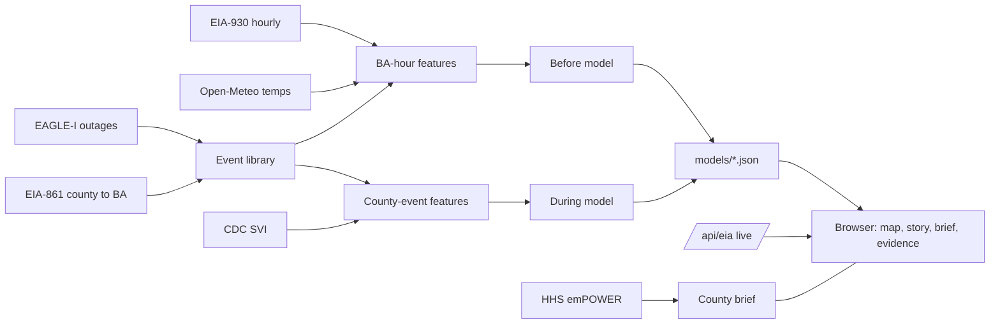

# Before, During, After (working name; project unnamed) — Master Spec
Status: locked   ·   Last updated: 2026-11-18   ·   Owner: Neil

This spec replaces `.plans/hollow-twin-spec.md` (v2) as the source of truth once it is locked. Why: another team (anudeep-bonagiri/hollow-twin) already ships a deployed 3D Hollow cutaway with the same name, and it uses no real-world data ("No AI ... there is no real data to train or test on", their `docs/PLAN.md`). No team on the track trains a model on real disasters. We stop competing on the Hollow simulation and make the real-world tool the product. Idea scoring: `ideation/ideas.md` → Round 17.

## One-liner
A county emergency office opens one page and sees, for the next 48 hours: how likely a grid emergency is, which places will stay dark longest, and how many people there depend on powered medical equipment. The models behind it are trained on hundreds of real US outages since 2015 and tested on disasters they never saw. The Hollow is what Earth becomes if these failures never stop; Earth in 2026 is the Hollow's beginning.

## The winning demo (30-second scene)
1. **0–8 s · The Hollow.** A dark 3D map seen from below the surface. Districts hang at different depths. Caption, in Hollow language: "Level 41 has been dark for 70 hours. 9,800 people need powered oxygen or dialysis. The Directorate says 246 died."
2. **8–14 s · The reveal.** The camera rises. A real basemap fades in under the districts, and the labels change to their first line: "Harris County." Caption: "This is not 2087. This is Texas, February 2021."
3. **14–24 s · Before and during.** The clock rewinds to Feb 13. The warning model's line crosses its threshold: "Warned N h before the first outage" (N is the measured test result). The check-first list appears: "These 14 counties: X people on home oxygen or dialysis. History says they stay dark longest." The clock plays; those counties stay dark longest, as predicted.
4. **24–30 s · The proof.** The Evidence view: every event in the library as one row (hits, misses, false alarms), trained on 2015–2020 and tested on 2021 onward. Line: "Hundreds of real disasters. Tested on ones it never saw. Use it for your county today."

Line for the judges: *"The Hollow has already started. We built the warning it never got."*

## Problem, user, and why now
- **The problem:** in a grid emergency, who dies depends on warning time and on who stays dark longest. The places that stay dark longest are often the most vulnerable ones: on Earth, these are the Hollow's "deep levels".
- **The user:** a county emergency manager or a mutual-aid group. They have public data but not the grid operator's internal data. They need: what is coming, who to check first, and what the last outages cost.
- **Why now:** Texas 2021 (official count 246), Winter Storm Elliott 2022 and recurring heat emergencies. The data to warn exists and is public; nobody turns it into a county-level warning with a measured track record.
- **Why it beats the other teams:** they model a fictional world. Ours runs on any US county today, with published hit and false-alarm rates.

## Track fit (Life underground: which of the 15 Hollow problems it covers, by number)
| # | Hollow problem | Earth analog (real data) | Part | Tier |
| --- | --- | --- | --- | --- |
| 1 | Warn before the power cuts out | Grid emergency warning, 48 h | Before | Must ship |
| 2 | The deep levels always lose | Who stays dark longest, by vulnerability; fair rotation | During | Must ship |
| 8 | Families cannot check on each other | Check-first list per county | During | Must ship |
| 10 | Care for people who cannot reach a clinic | Electricity-dependent Medicare users (HHS emPOWER) per county | During | Must ship |
| 3 | The deep levels get hotter | Heat events and heat-while-dark hours | Ladder 1 | Stretch |
| 9 | The official numbers do not match | Excess deaths against the official count | Ladder 2 | Stretch |
| 13 | Is the air safe; get the truth to everyone | Smoke-day warning from EPA monitor history | Ladder 3 | Stretch |
| 4 | Catch bad water | Drinking-water violation risk (EPA SDWIS) | Ladder 4 | Stretch |

Must ship covers 4 problems. Each ladder step that passes its gate adds one.

## Scope
### Must ship (demo path)
1. **Data pipeline** (`data/`): EIA-930 hourly by balancing area 2015 → now; EAGLE-I county outages 2014–2025; EIA-861 county → utility → balancing area map; hourly temperature per balancing area (Open-Meteo archive); CDC SVI by county; HHS emPOWER by county; Census county population; us-atlas county shapes.
2. **Event library:** every event the label rule finds. Label rule (fixed before training): at least 1% of a balancing area's customers out for 4 h or more. The expected count is 300+; the real count goes in the README. Add DOE OE-417 reports as a check if the new site (doe417.pnnl.gov) offers a download.
3. **Before model (warning):** LightGBM, one row per balancing area per hour. Target: an event starts within 48 h. Inputs: demand against the day-ahead forecast, demand against its recent peak, generation by fuel and its drops, interchange, temperature and its anomaly, hour and season. **Train 2015–2020, test 2021 → now.** Texas 2021 and Elliott 2022 are test events. Report: lead time per event, recall at 12 h lead, false alarms per area per year, against two baselines (our current hand rule and "demand above forecast by x%").
4. **During model (who stays dark):** LightGBM, one row per county per event. Target: hours with 10% or more of customers out. Inputs: event features, county customers, utility type, past outage history, rurality. Outputs: (a) the check-first list = predicted dark hours × emPOWER users; (b) the equity result across all events: dark hours by SVI quartile, with a bootstrap interval; (c) a fair rotation for rotating-shed events (Uri, Elliott): the same customer-hours out, spread evenly with a life-support floor, and the hours it would have saved the top SVI quartile.
5. **Browser inference:** models exported to JSON and run in TypeScript. The live site needs no model server.
6. **Map** (deck.gl + MapLibre, free basemap, no key): every US county, extruded **downward** by vulnerability and dark hours ("depth = vulnerability"). Labels show both names: "Harris County" on line 1, "Level 41" smaller on line 2. A shared clock replays any event.
7. **Story mode:** the 30-second scene above plays by itself from a URL (`?story=texas2021`), with captions and camera moves. The video is recorded from it.
8. **County brief:** one page per county, shareable by URL, clean when printed: risk now and its top reasons, people affected, electricity-dependent people, the check-first list, past outages.
9. **Evidence view (the data export, made visible):** every library event as one row with its timeline strip (alert, first outage, peak), sortable; summary metrics; download as CSV and JSON. The same files are served as a static JSON API (`/data/v1/events.json`, `/data/v1/counties/<fips>.json`).
10. **Live today:** a Vercel function fetches the last 7 days from the EIA API (key on the server) and the browser model scores today. If the API fails, the page says "cached" and shows the last saved day.
11. **Impact numbers:** measured first: hours of warning, people in the warned area, electricity-dependent people reached, false-alarm rate. Lives saved only as a labelled estimate with its assumptions in a hover, and only if Ladder 2 passes (it supplies excess deaths per event).
12. **Deploy:** a public Vercel URL that works in a private window and on a phone.

### Nice to have: the ladder (in order; a step starts only when the one before it passes its gate)
1. **Heat (problem 3):** summer events are already in the library. Add heat-while-dark hours per county to the brief and the map.
2. **True count (problem 9):** expected deaths per state-week from NCHS weekly counts (Poisson model, trained on weeks with no disaster; COVID deaths as an input for 2020–2023). Excess deaths with a 95% interval after each event, against the sourced official count. Test cases: Texas Feb 2021, Pacific Northwest heat dome Jun 2021, Hurricane Ian 2022; Maria 2017 if NCHS covers Puerto Rico.
3. **Air (problem 13):** next-day unhealthy PM2.5 per county from EPA AQS daily monitor files and weather. Map layer and brief line.
4. **Water (problem 4):** risk that a drinking-water system has a health-based violation next quarter, from EPA SDWIS history. Brief line.

### Explicit non-goals
- A detailed Hollow simulation. The Hollow is the frame, the opening and the labels; the other team does the simulation better.
- The 9 hand-written modules and the PixiJS cutaway (`app/src/product`, `app/src/sim`, `app/src/world`) leave the demo path. Keep the code; do not delete it.
- Any data about individual people. County aggregates only.
- Claims that the model predicts the future with certainty. A test result shows what it would have said on past data it never saw.
- Countries other than the US (no consistent public outage data).
- Accounts and login.

## Architecture
```
data/                       Python (uv): fetch + build with DuckDB; raw files in data/raw (git-ignored)
  fetch/                    eia930.py, eaglei.py, eia861.py, weather.py, svi.py, empower.py, census.py
  build/                    labels.py (event library), features_ba_hour.py, features_county_event.py
  out/                      small committed outputs with source metadata (parquet + JSON)
models/                     Python: train_warn.py, train_dark.py, eval.py, export.py (trees → JSON)
  ladder/                   heat.py, count.py, air.py, water.py
app/                        Vite + React + deck.gl + MapLibre
  public/models/            exported model JSON
  public/data/v1/           events.json, counties/<fips>.json, evidence.csv (the static API)
  src/model/                TypeScript tree evaluator + feature builder (must match Python exactly)
  src/earth/                map, layers, clock, county labels (Earth + Hollow names)
  src/story/                story script: events, captions, camera moves
  src/brief/                county brief page + print styles
  src/evidence/             evidence view + downloads
  src/live/                 today page (calls /api/eia)
  api/eia.ts                Vercel function: EIA key proxy, 7-day window
```



**Parity check:** `models/export.py` writes 200 test rows with the Python predictions. A test in `app/` runs the TypeScript evaluator on them and fails on any difference above 1e-6.

## Data & seeding plan
| Data | Source | Size | Notes |
| --- | --- | --- | --- |
| EIA-930 balance | eia.gov/electricity/gridmonitor six-month CSV files (confirmed reachable) | about 43 MB per half-year, about 900 MB in all | No key for bulk files |
| EIA-930 live | EIA API v2 `electricity/rto/region-data` | small | Free key, server side only |
| EAGLE-I outages | figshare article 24237376 (ORNL), 2014–2025 (confirmed) | 0.6–1.4 GB per year, about 13 GB | Aggregate with DuckDB straight from CSV; commit only aggregates |
| County → BA | EIA-861 Service Territory + Balancing Authority files | small | A county served by several BAs: weight by customers |
| Temperature | Open-Meteo historical archive, one point per BA (largest load center) | about 65 × 10 years hourly | Rate limits: fetch once, cache |
| Vulnerability | CDC/ATSDR SVI county file | small | Use one SVI year for all events; say so |
| Powered medical equipment | HHS emPOWER county data | small | Medicare users only; say so |
| Population, shapes | Census county estimates; us-atlas counties-10m (public domain) | about 1 MB | |
| Ladder 2 | CDC NCHS weekly deaths by state (data.cdc.gov `3yf8-kanr`, `muzy-jte6`) | small | Official counts typed in with citations |
| Ladder 3 | EPA AQS daily PM2.5 files | about 50 MB per year | |
| Ladder 4 | EPA SDWIS violations | about 100 MB | |

Seeding: story mode, the brief and the evidence view read only committed JSON, so the demo never needs the network. Only the live page calls the EIA API, and it has the cached fallback.

## UI / UX direction
- **Feel:** dark, quiet, exact. The map is the screen; panels are thin and come in from the edges. At most about 12 lines of text visible outside a hover (1080p video rule).
- **The depth image:** counties extruded downward, deeper for higher vulnerability and longer darkness. From below (story opening) it reads as the Hollow's levels; from above, with the basemap, it reads as a US map.
- **Labels:** both names. Line 1: the Earth name ("Harris County"). Line 2, smaller and dimmer: the Hollow name ("Level 41"). The level number comes from the county's SVI percentile, so the same county always has the same level.
- **Key screens:** Map (replay any event, today) · County brief · Evidence · Story mode.
- **References:** copy from `inspiration/`; deck.gl's 3D extruded county examples for the map.
- **Polish:** `/better-interface`, `/animate` for the reveal and the clock, `/agentation`.

## Hardware (if hybrid)
None. Software only.

## Workstreams
Owners are not fixed (team decision, Nov 18); each person picks an open line and stays inside its directories.

| # | Workstream | Owner | Files/dirs owned | Depends on | Done when |
| --- | --- | --- | --- | --- | --- |
| 1 | Data + event library | open | `data/` | — | Event library and both feature tables built; counts and sources written in `data/README.md` |
| 2 | Models + evaluation | open | `models/` | 1 | Both models trained on 2015–2020, tested on 2021+, metrics against baselines in `models/RESULTS.md`; JSON exported with parity rows |
| 3 | Map + story mode | open | `app/src/earth`, `app/src/story`, `app/src/ui` | 2 (export format; can start on stub JSON) | Story mode plays the 30-second scene without input at 60 fps |
| 4 | Brief, evidence, live, inference | open | `app/src/model`, `app/src/brief`, `app/src/evidence`, `app/src/live`, `app/api`, `app/public/data` | 2 | Parity test passes; brief prints; evidence downloads; live page works with the network off (cached) |
| 5 | Ladder (heat → count → air → water) | whoever finishes 1 or 2 first | `data/fetch` (new files only), `models/ladder` | 1, 2 | Each step: gate passed, one brief line and one map layer |
| 6 | Pitch + video + write-up | open | `pitch/` | all | Video uploaded; Devpost text done |

## Step-by-step plan (US Eastern; submit by Fri 6:00 pm)
**Wed night (now → about 3 am)**
1. Lock this spec. Mark v2 superseded. Set up `data/` with uv and DuckDB.
2. Download EIA-930 (2015 → now) and EAGLE-I (2015 → 2024) in the background. Fetch EIA-861, SVI, emPOWER, Census, shapes, Open-Meteo.
3. Build the county → BA map and the event library. **G1 (3 am): the library exists, with an event count and Texas 2021 and Elliott in it.**
4. In parallel: workstream 3 starts the deck.gl map on stub JSON.

**Thu morning (8 am → 12 pm)**
5. Feature tables; train and evaluate the Before model. **G2 (10 am): the model beats both baselines on 2021+ (more events warned at 12 h, at the same or fewer false alarms).** If it fails: ship the best baseline rule, evaluated on the same library, and say so.
6. Train the During model and the equity result.
7. Export, parity test, story mode on real JSON.
8. **12:00 pm: deploy. Feature freeze for must-ship (G3).**

**Thu afternoon (12 pm → 6 pm)**
9. Brief, evidence view, downloads, static API.
10. Live page with `/api/eia` and the cached fallback.
11. Ladder 1 (heat). Then Ladder 2 (true count) if Ladder 1 passed.
12. `/codex review`, `/webapp-testing` on story mode, fix bugs.

**Thu evening (6 pm → midnight)**
13. `/pitch`: the script. Check every on-screen number against `models/RESULTS.md` and its source.
14. Ladder 3 (air) only if everything above is green.

**Fri (8 am → 6 pm)**
15. Record the video from story mode; overlays with `/hyperframes`.
16. Devpost text with `/ste`, then `/humanizer`.
17. 2:00 pm: final deploy; check in a private window and on a phone. Ladder 4 (water) is cut unless it is already done.
18. **6:00 pm: submit.** Enter all 4 members.

## Cut priority (cut from the top when a gate fails)
1. Ladder 4 (water), then 3 (air), then 2 (true count), then 1 (heat)
2. Static JSON API (keep the CSV download)
3. Live today page (keep cached days)
4. Fair rotation counterfactual (keep the equity result)
5. Labelled lives estimate
6. 3D depth extrusion (fall back to a 2D color map with depth in the legend)

**Never cut:** the event library, the Before model test on unseen events (or the baseline fallback), the check-first list, story mode with the reveal, the evidence view, the deploy, the video.

## Risks & fallbacks
| Risk | Fallback |
| --- | --- |
| EAGLE-I is too big to process in time | Process 2015–2024 by year in DuckDB, keep only BA-hour and county-event aggregates; drop 2014 and 2025 |
| County → BA mapping is messy | Use the largest-customer BA per county; list the counties where it is ambiguous |
| The Before model does not beat the baselines | Ship the best baseline rule with the same evaluation; the claim becomes "tested on N events" |
| Few events in the test years | Report the count and the interval; also show the leave-one-year-out result |
| TypeScript and Python predictions differ | Parity test blocks the deploy; fall back to precomputed predictions for library events |
| EIA API fails during judging | Cached days, labelled "cached" |
| deck.gl is slow on a phone | Lower county detail on small screens; 2D fallback |
| Story too dense for video | Captions only; panels hidden in story mode |

## Ethics
- County aggregates only; no person-level data, no addresses.
- emPOWER counts are de-identified county totals from HHS.
- Death counts are sensitive: show ranges and sources, never "the officials lied", only "the counts differ by X".
- Do not tell real people to act on the live page in an emergency without saying it is a research prototype.

## Demo script & pitch beats (3 min, assumed)
1. **0:00–0:30 · The scene.** Hollow first, then the reveal (above).
2. **0:30–1:10 · Before.** How the warning works, in one sentence. The Texas replay, then Elliott. The evidence table: N events, recall, false alarms, against the baselines.
3. **1:10–1:50 · During.** The check-first list and the equity result: "In N outages, the most vulnerable quarter of counties stayed dark X% longer." The fair rotation.
4. **1:50–2:20 · The county brief.** Open Harris County today (live). Print it. "An emergency office can use this Monday."
5. **2:20–2:45 · Ladder results.** Each passed step in one shot (heat, true count, air).
6. **2:45–3:00 · Close.** Back to the depth map from below. "The Hollow has already started. Here is the warning it never got." The URL.

## Decisions made in this interview
| Decision | Answer | Source |
| --- | --- | --- |
| Direction | Earth is the product; real models trained on real disasters; Hollow is the frame | User |
| Name | Unnamed for now; "Hollow Twin" is taken | User |
| Earth user | County emergency office / mutual-aid group | User |
| Earth and Hollow | Blended: the Hollow is what Earth became; Earth today is the Hollow's beginning | User |
| Model scope | Before + During must ship; After (true count) is a stretch | User |
| Current app | Refocus on an Earth map with population data; Pixi cutaway and 9 modules leave the demo path | User (keep the code: Claude's default) |
| Blend visual | Depth = vulnerability, counties extruded downward | User |
| Map scope | All US counties; Texas 2021, Elliott 2022 and one heat event as heroes | User |
| Map stack | deck.gl + MapLibre in `app/` | User |
| Extra analogs | All of them, one after another: heat → true count → air → water, each gated | User (order: Claude's recommendation) |
| Labels | EAGLE-I rule (1% of a BA's customers for 4 h+), OE-417 as a check if found | User (thresholds: Claude's default) |
| Live page | Live EIA with cached fallback | User |
| Impact metric | Measured numbers first; lives saved only as a labelled estimate | User |
| Opening | Hollow first, then the reveal | User |
| UI labels | Both names at once | User; Claude's change: the Hollow name is a smaller second line |
| Output | County brief and a visual data export (evidence view + CSV/JSON + static API) | User |
| Train/test split | Train 2015–2020, test 2021 onward | Claude's default (removes "tuned on the test event") |
| Model type | LightGBM for both; Poisson model for the true count | Claude's default |

## Open questions
- The real event count from the label rule (known at G1).
- Whether OE-417 has a downloadable file on its new site.
- Does NCHS weekly data include Puerto Rico (decides whether Maria is a Ladder 2 case)?
- Official death counts for each Ladder 2 case: confirm from primary sources.
- The judging criteria and the video length: ask at the Thu JC check-in.
- The final project name.
